# FormUp - Football Coaching Android App
[](https://github.com/nafsampson/Coaching-Android-App/actions/workflows/android-ci.yml)

**Plan sessions. Prepare the squad. Review performance.**

FormUp is a native Android application for managing the everyday responsibilities of a football coach. It brings squad management, training attendance, tactical lineups and performance reporting into one interface, with support for connectivity interruptions.

## App Preview
<details open>
<summary><strong>Explore FormUp - click to expand or collapse</strong></summary>

### Sign In

Access FormUp using email and password or Google sign-in.

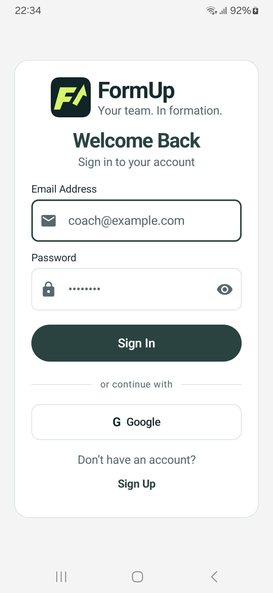

### Home - Light and Dark Mode

View the next match and quickly access attendance, lineups and statistics.

<table>
  <tr>
    <th>Light mode</th>
    <th>Dark mode</th>
  </tr>
  <tr>
    <td valign="top">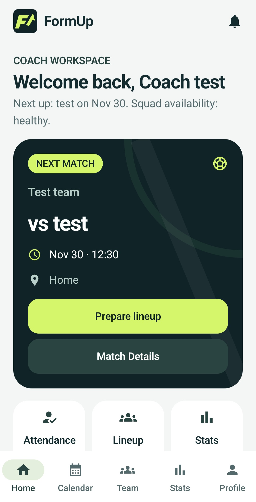</td>
    <td valign="top">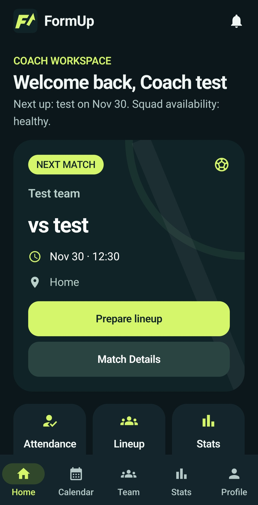</td>
  </tr>
</table>

### Calendar, Team and Lineup

Manage scheduled events, review player availability and prepare the starting eleven.

<table>
  <tr>
    <th>Calendar</th>
    <th>Team</th>
    <th>Tactical lineup</th>
  </tr>
  <tr>
    <td valign="top">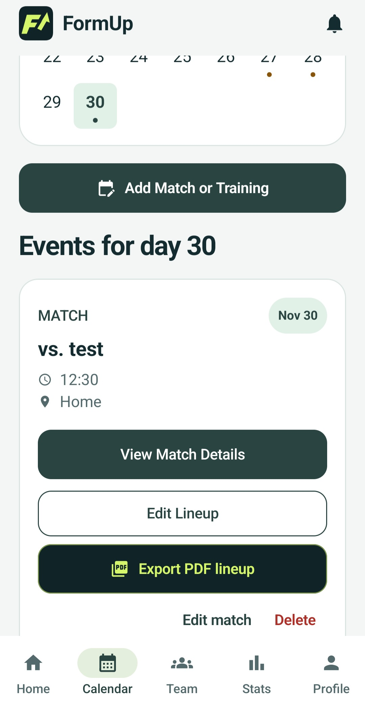</td>
    <td valign="top">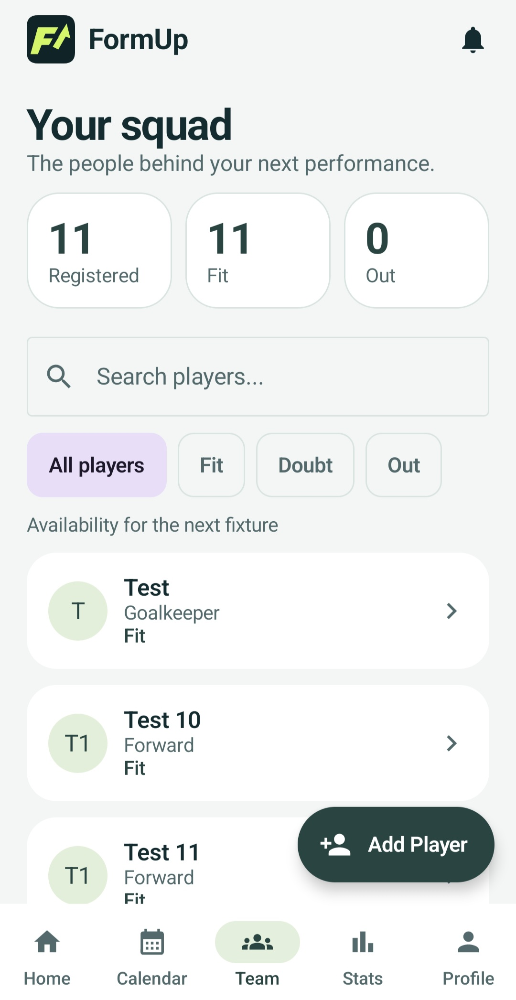</td>
    <td valign="top">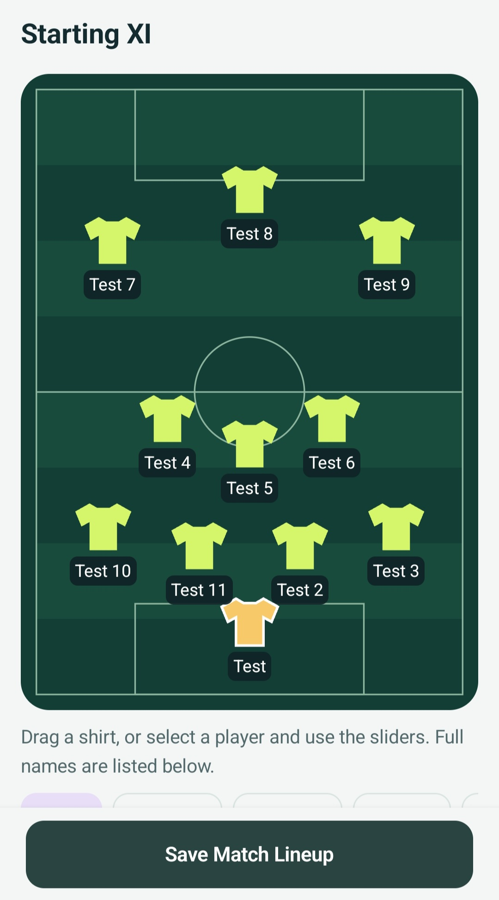</td>
  </tr>
</table>

### Statistics and Profile

Review team performance, export season information and view the coach profile.

<table>
  <tr>
    <th>Season analytics</th>
    <th>Coach profile</th>
  </tr>
  <tr>
    <td valign="top">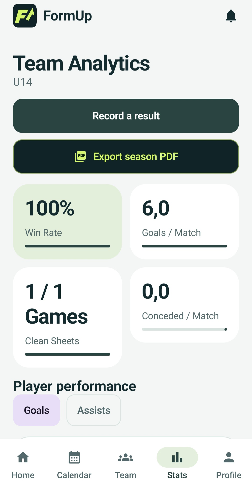</td>
    <td valign="top">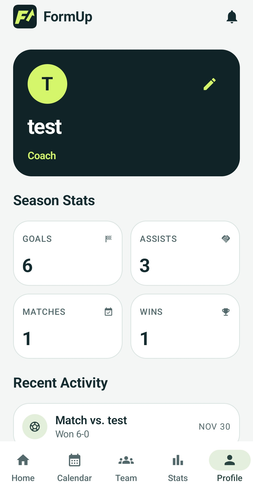</td>
  </tr>
</table>

### Preferences and Languages

Personalise the theme, configure reminders and enable biometric app locking. FormUp supports English, Afrikaans and isiXhosa; the screenshots below show English and Afrikaans.

<table>
  <tr>
    <th>Light preferences</th>
    <th>Dark preferences</th>
    <th>Afrikaans</th>
  </tr>
  <tr>
    <td valign="top">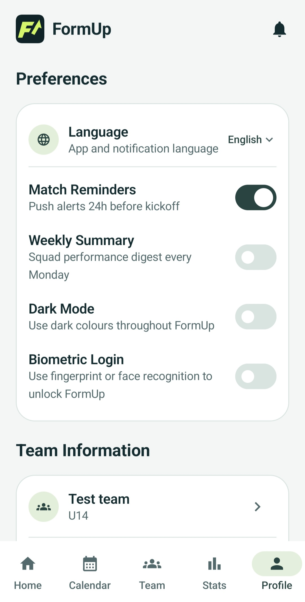</td>
    <td valign="top">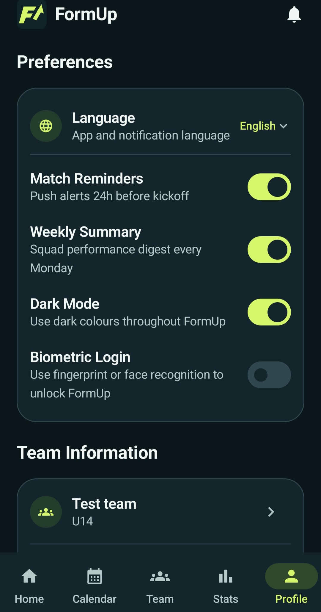</td>
    <td valign="top">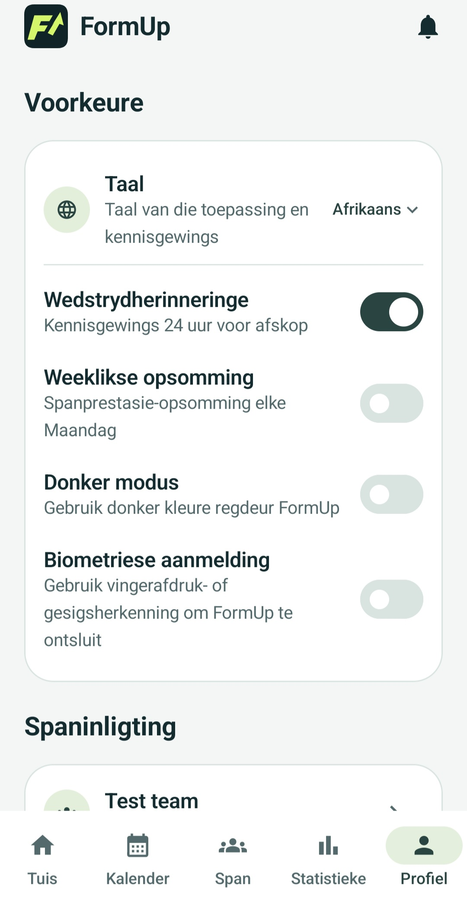</td>
  </tr>
</table>

</details>

## Features

- **Coach dashboard:** access upcoming training attendance, the next match, lineup preparation and squad availability.
- **Squad management:** maintain player profiles and track fit, doubtful and unavailable players.
- **Calendar:** create and edit training sessions and matches, manage dates and times, and add session notes.
- **Attendance:** review changes before confirming attendance records.
- **Tactical lineups:** select starters and substitutes, arrange players on the pitch and save formations.
- **Performance tracking:** record match scores and player statistics, and review match reports and season summaries.
- **PDF exports:** share lineup and season information outside the app.
- **Offline support:** retain supported changes locally and queue them for synchronisation when connectivity returns.
- **Account protection:** email/password and Google authentication, plus optional biometric app locking on supported devices.
- **Personalisation:** light and dark themes, with English, Afrikaans and isiXhosa resources.
- **Notifications:** Firebase Cloud Messaging integration for reminders delivered through the backend.

## Technology

| Area | Technology |
| --- | --- |
| Language | Kotlin |
| Interface | Jetpack Compose and Material 3 |
| State and navigation | ViewModel, Kotlin coroutines, Navigation Compose |
| Networking | Retrofit and OkHttp |
| Local persistence | Room |
| Background synchronisation | WorkManager |
| Authentication | Firebase Authentication and Android Credential Manager |
| Notifications | Firebase Cloud Messaging |
| Backend | Separate ASP.NET Core API with Cloud Firestore |
| Testing and automation | JUnit and GitHub Actions |

## Architecture

Compose screens delegate application state and actions to ViewModels and controllers. API services handle authenticated requests, while a local cache and pending-write queue support offline use and subsequent synchronisation.

```text
Compose screens
      |
ViewModels and controllers
      |
API services / local cache and pending writes
      |
Authenticated ASP.NET Core API
      |
Cloud Firestore
```

Firebase Authentication supplies the identity used for API requests. Firestore administration and reminder delivery belong to the backend; the Android app does not require a service-account private key.

## Getting started

### Requirements

- Android Studio compatible with the project's Android Gradle Plugin.
- Android SDK 34.
- An Android device or emulator running Android 7.0 / API 24 or newer.
- Internet access for initial dependency and toolchain downloads.
- A compatible FormUp API and Firebase project for authentication and server-backed features.

Use the included Gradle wrapper. The project specifies a Java 21 Gradle daemon toolchain, with Java and Kotlin compilation targeting Java 17.

### Build and run

1. Clone the repository and open its root folder in Android Studio.
2. Allow Gradle synchronisation and dependency downloads to complete.
3. Configure your Firebase project and API if running an independent copy, following the instructions below.
4. Select a device and run the `app` configuration.

To build from PowerShell in the project root:

```powershell
.\gradlew.bat assembleDebug --max-workers=1 --no-parallel
```

The debug APK is generated at `app/build/outputs/apk/debug/app-debug.apk`.

### Configure an independent environment

The checked-in client configuration references the existing project environment. To use your own environment:

1. Create a Firebase project and enable Email/Password and Google authentication.
2. Register the Android application using the `applicationId` in `app/build.gradle.kts`, currently `com.nafees.formup`. Register a different application ID if you change it.
3. Generate the signing report and add your build's SHA-1 and SHA-256 fingerprints to Firebase:

   ```powershell
   .\gradlew.bat signingReport --max-workers=1 --no-parallel
   ```

4. Download your Firebase Android configuration to `app/google-services.json`.
5. Update the explicitly configured `default_web_client_id` in `app/src/main/res/values/strings.xml` to your project's Web OAuth client ID.
6. Update `FormUpApi.BASE_URL` in `app/src/main/java/com/formup/app/data/FormUpApi.kt` to your own HTTPS API address.
7. Configure the backend to use the same Firebase project.

The application ID is separate from the Kotlin package and Android namespace, which remain `com.formup.app`.

## Offline behaviour

Supported changes within an authenticated account are retained locally and queued for upload. Synchronisation requires connectivity and valid authentication. Initial sign-in, uncached server data and server-delivered notifications require connectivity. Local storage is not a substitute for a server backup.

## Testing and continuous integration

Run the unit tests from PowerShell:

```powershell
.\gradlew.bat testDebugUnitTest --max-workers=1 --no-parallel
```

Tests cover date handling, upcoming-event selection, attendance drafts, calendar navigation, lineup rules, formation validation, PDF text layout and offline queue processing.

The Android CI workflow runs unit tests and builds a debug APK for pushes and pull requests targeting `main`. Test reports and the debug APK are uploaded as workflow artifacts. The workflow does not publish to Google Play or deploy the backend.

## Project structure

```text
app/src/main/java/com/formup/app/
|-- data/           API services, models and date handling
|-- export/         PDF generation and pitch rendering
|-- notifications/  Push registration and notification handling
|-- offline/        Local database, pending writes and synchronisation
|-- security/       Account sessions and biometric locking
`-- ui/             Screens, state, controllers and theme

app/src/main/res/   Localised strings and Android resources
app/src/test/       Unit tests
.github/workflows/  Android build and test automation
```

## Configuration and credentials

The Android app uses `google-services.json` to identify its Firebase project and configure client services. This file contains client configuration, not Firebase Admin credentials. Access to application data is protected through authentication, backend authorisation and database access controls.

Sensitive credentials must remain outside source control, including service-account files, private keys, signing keystores, passwords and deployment credentials. Store backend secrets in the hosting environment and automation secrets in GitHub Actions secrets.

To run an independent deployment of FormUp, configure your own Firebase project and backend using the setup instructions above.
